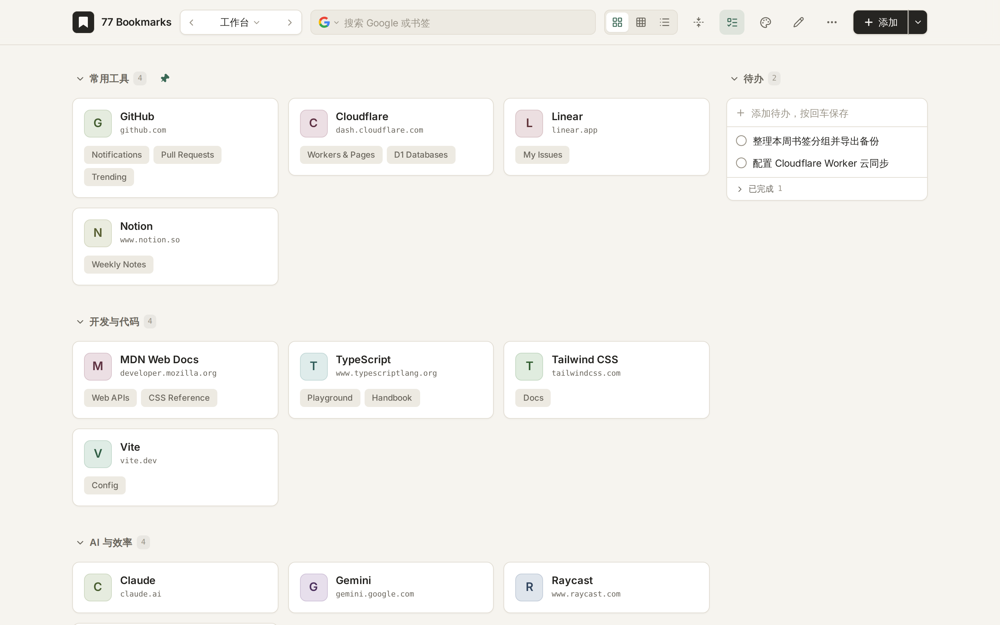
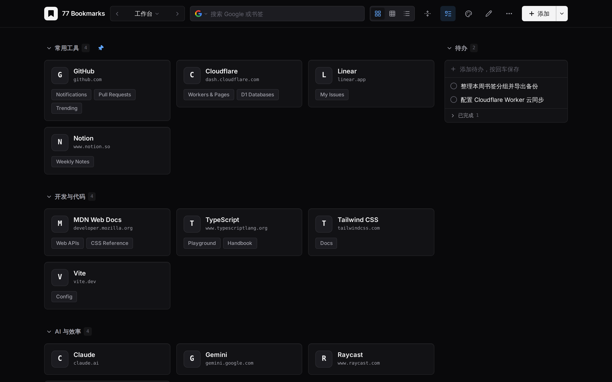

# 77 Bookmarks

[中文](README.md) | [English](README.en.md)

A local-first Chrome / Edge New Tab bookmark extension, with optional Docker self-hosting and a lightweight right-click clipper extension. Both editions share the same UI and data model.

Features include multiple desktops, pinned groups, drag-and-drop reordering, Large Card / Small Card / List views, configurable group columns, optional usage-based auto-sorting, cross-desktop search, 4 visual styles (Paper / Linear / Swiss / Brutalist), light/dark themes, a built-in to-do panel, and click statistics. When adding URLs, each domain becomes a card and sub-paths become links on that card—bookmarks on the same domain within a desktop are automatically merged.

## Preview

| Light Theme (Paper) | Dark Theme (Linear) |
|---|---|
|  |  |

## Docker Self-Hosting (Optional)

Ideal if you want to share bookmarks across multiple devices without replacing your browser's New Tab page. Data is stored in an SQLite database inside the container's `/data` volume, protected by single-user password login, and uses the exact same backup format as the extension edition for seamless import/export.

> Note: The self-hosted edition stores data directly in the server's SQLite database and does not show the extension's "Cloud Sync" settings tab.

Build and run from source:

```bash
ADMIN_PASSWORD='your-strong-password' docker compose up -d --build
```

Or pull the prebuilt multi-arch image (`linux/amd64`, `linux/arm64`) from GitHub Container Registry:

```bash
docker run -d \
  --name 77bookmarks \
  --restart unless-stopped \
  -p 8080:8080 \
  -e ADMIN_PASSWORD='your-strong-password' \
  -v 77bookmarks-data:/data \
  ghcr.io/zxxx98/77bookmarks:latest
```

Listens on port `8080` by default (override with `PORT=9000`). Environment variables:

| Variable | Description | Default |
|---|---|---|
| `ADMIN_PASSWORD` | Login password, at least 8 characters (required) | None |
| `PORT` | Host port (compose) or container listening port | `8080` |
| `TRUST_PROXY` | Set to `true` behind an HTTPS reverse proxy to honor `X-Forwarded-*` headers | `false` |

For public access, place it behind an HTTPS reverse proxy (Nginx / Caddy / Traefik). If your proxy buffers responses, disable buffering for `/api/events` so real-time multi-tab updates work properly.

### Companion Right-Click Clipper Extension

Since the self-hosted edition does not override the New Tab page, you can install the lightweight clipper extension for right-click bookmarking:

- Download `77bookmarks-clipper-v*.zip` from [GitHub Releases](https://github.com/zxxx98/77bookmarks/releases) and extract it, or build from source:

```bash
npm install
npm run build:clipper
```

1. Open `chrome://extensions` (or `edge://extensions`), enable **Developer mode**, and load the extracted folder or **`dist-clipper/`**.
2. Sign in to your self-hosted web app, open **More → System Settings → Right-Click Clipper** (`更多 → 系统设置 → 右键插件`), and click **Generate Connection Code** (`生成连接码`).
3. Click the clipper extension icon (or open its Options page), paste the connection code, grant access to your server URL, and choose a default desktop and group.
4. You can now right-click any page or link and choose **Add current page to 77 Bookmarks** or **Add this link to 77 Bookmarks**, or select text first and choose **Add selected text to 77 Bookmarks**.

The clipper only requests `contextMenus`, `storage`, `activeTab`, `scripting`, and permission for your specific server URL. Connection codes only allow reading desktops/groups and adding bookmarks—they cannot modify, delete, or export data.

## Extension Installation & Build

Requires Chrome / Edge 120+. You can download `77bookmarks-extension-v*.zip` from [GitHub Releases](https://github.com/zxxx98/77bookmarks/releases) and extract it, or build from source (requires Node.js 22.12+):

```bash
npm install
npm run build:extension
```

1. Open `chrome://extensions` (or `edge://extensions`) and enable **Developer mode** in the top right.
2. Click **Load unpacked** and select the extracted folder or the generated **`dist-extension/`** directory. (`extension/` is the source directory and cannot be loaded directly.)
3. Open a new tab. If the browser asks whether to keep the New Tab changes, choose to keep them.
4. Pin the extension icon to your toolbar for quick bookmarking.

Once installed, daily use does not require running npm, Node.js, or any local server. Do not open HTML files directly via `file://`.

When updating, extract or rebuild into the same directory and click **Reload** in `chrome://extensions`. Keep the same directory and browser profile—do not uninstall to upgrade, and export a backup before changing extension IDs or directories.

If multiple extensions override the New Tab page, enable the one you want in `chrome://extensions`.

## Bookmarking Pages

- Click the toolbar icon, pick a desktop and group, and save the current page.
- Right-click on any blank area of a page and select **Add current page to 77 Bookmarks**.
- Right-click on a link and select **Add this link to 77 Bookmarks**.
- Select some text, right-click it and choose **Add selected text to 77 Bookmarks** (`添加选中文字到 77 Bookmarks`). The bookmark is named after the first 30 characters of the selection, and opening it makes the browser scroll to that text and highlight it; if the page has changed and the text is gone, it opens as a normal link.
- Default keyboard shortcut: `Alt+Shift+B` (customizable at `chrome://extensions/shortcuts`).
- Context menus and shortcuts remember the last desktop and group selected in the popup, falling back to the first desktop and default group if deleted.
- On the bookmark board, you can also paste a URL directly or click **Add** (`添加`).

**Create a group:** Click the dropdown arrow next to **Add** in the top bar → **New Group** (`新建分组`), type a name, and press `Enter`. No need to enter edit mode. On mobile, tap `+` in the top bar for the same menu.

When saving from the current page, the browser's page title is used automatically. When pasting or typing a sub-URL in the board's Add dialog, an editable **Sub-link Name** field appears, prefilled with the last path segment while attempting to fetch the page title. If the extension already has host permission, it fetches in the background; otherwise, click **Fetch Page Title** to grant on-demand permission. Requests time out after 3 seconds and fall back to the path name; any manual edit you make won't be overwritten. Clicking Add saves immediately without waiting for the fetch. Site cards remain named after their domain, and right-clicking a link defaults to its path segment.

To rename existing sub-links, right-click the site card → **Edit** (`编辑`), edit the name under **Sub-links**, and press `Enter` or click outside (or enter top-bar **Edit** mode and click the pencil icon on the card).

Only `http://` and `https://` URLs are supported (including LAN and `localhost`). Browser internal pages, extension pages, and `file://` URLs are not supported. When a restricted page prevents injecting an on-page toast, the result is shown via the toolbar badge.

## Local Data & Offline Use

In the extension edition, bookmarks, to-dos, click stats, and cached icons are stored in the extension's IndexedDB. Lightweight preferences are mirrored to `chrome.storage.local`, and `localStorage` caches startup appearance. Data is isolated per browser profile and does not sync via your browser account.

- View, search, add, edit, reorder, back up, and restore local data completely offline.
- Opening external sites, web search, and loading uncached remote icon URLs still require network access.
- Changes are persisted in database transactions first before notifying other open bookmark tabs to refresh.
- The extension service worker sleeps according to Manifest V3 rules and resumes cleanly from IndexedDB on wake or browser restart.

**Export full backups regularly. Uninstalling the extension, deleting the browser profile, or clearing its site storage will erase local data.**

Extension data is stored independently from browser bookmarks, and you can import Chrome / Edge HTML bookmark exports.

## Icons & Permissions

Icons are read from Chrome's favicon cache and saved locally; if unavailable, a letter monogram is displayed. Card editing supports uploading an image (up to 100 KB) or entering a remote image URL. Uploaded and cached icons work offline; remote URL-only icons may fall back to letters when offline, and backups store only the URL.

Extension permissions:

| Permission | Purpose |
|---|---|
| `storage` | Save extension preferences and last-used bookmark destination |
| `contextMenus` | Right-click menu entries for pages and links |
| `activeTab` | Read the current tab's URL and title when bookmarking |
| `scripting` | Display on-page confirmation toasts after bookmarking |
| `favicon` | Read cached site favicons from the browser |
| `alarms` | Debounced uploads and 15-minute sync checks when cloud sync is enabled |
| Optional host permissions | Fetch sub-URL titles on demand or access your configured WebDAV server |

Browsing history is never read. Cloud sync is disabled by default and makes no network requests unless explicitly enabled. WebDAV host permissions are requested on demand. If you configure a remote icon URL, the browser will fetch that image directly.

## Private Spaces

Nothing in the interface leads to the private spaces; they are reached by shortcut only: `Alt+P` asks for a password and opens the space it belongs to, `Alt+Shift+P` creates a space (at least 8 characters). They cannot be opened on a device without a keyboard. Each space is a board of its own, with its own desktops, groups, bookmarks and to-dos.

- **Several spaces, invisible to each other**: different passwords open different spaces. Neither the interface nor the storage has a list of spaces, so knowing one password does not reveal whether there are others.
- **Ciphertext only**: contents are encrypted in the page (scrypt + XChaCha20-Poly1305) before they are stored. The browser's local database, the self-hosted server's database, cloud sync and full backups only ever hold a bag of equally sized encrypted records, mixed with random ones from the first start, so nothing shows how many spaces there are, or whether there are any.
- **Opened in incognito**: every address in a space opens in an incognito window. The extension edition needs no extra permission and no "Allow in Incognito"; the self-hosted edition asks the connected right-click extension to open it, and without one offers to copy the link rather than quietly opening it in the normal window.
- **No traces**: inside a space no icons or titles are fetched, no clicks are counted, no intranet address is probed and nothing is written to the browser's local state. The password lives only in the memory of the current tab: closing or reloading it, pressing `Alt+P` or five idle minutes lock the space.
- **Managing**: with a space open, the "隐私空间" button in the top bar locks it, changes its password or deletes it. That button is only there while a space is open.

Limits worth knowing:

- **A password cannot be recovered**; forgetting it loses the contents for good.
- Whoever obtains the ciphertext can guess passwords offline, so the strength of the password is the whole defence.
- Someone who can compare the storage over time (a server administrator, a cloud that keeps old versions) can estimate the number of active spaces from which records change together. The contents stay safe.
- The page of the self-hosted edition is served by the server, so whoever can change the server's code can steal a password in the page; the extension edition does not have this problem.
- When the same space is changed in two places at once, the later one is asked to unlock again; when two devices change it offline, the cloud's copy is kept.

## Backup & Restore

Available under **More → System Settings → Backup & Restore** (`更多 → 系统设置 → 备份与恢复`):

- **Full Backup (v3)**: Includes all desktops, groups, cards, sub-links, local icons, click stats, to-dos, system settings, theme, and search engine preferences.
- **Current Desktop Only (v2)**: Export a single desktop when you have multiple, compatible with legacy bookmark backups (excludes global settings, to-dos, and stats).
- **Add as New Desktop**: Imports only the desktops from the backup with new IDs, without overwriting existing to-dos or global settings.
- **Replace All Data**: Replaces all desktops; v3 backups also restore to-dos, settings, and stats, while legacy backups preserve existing to-dos and settings.

Files are validated before import and written in a single transaction—any format error or write failure rolls back cleanly. Supports up to 20 desktops.

Also supports importing v1/v2 bookmark backups and Chrome / Edge exported **HTML bookmark files**: preview item counts and import as a new desktop, converting nested folders into groups and merging same-domain URLs into cards (non-HTTP/HTTPS URLs are skipped).

## Cloud Sync (Optional)

Available in the extension edition under **More → System Settings → Cloud Sync** (`更多 → 系统设置 → 云同步`), disabled by default. Supports **Cloudflare Worker + D1** and **WebDAV**. Enter the same server URL and credentials on each device, enable sync, and save (or click **Test Connection** first).

- Syncs desktops, groups, cards, sub-links, to-dos, click stats, and system settings; appearance preferences (theme, search engine, etc.) stay per-device.
- Cached icon images are not uploaded; each device fetches them from its browser favicon cache. Custom remote icon URLs sync with cards, while uploaded images stay local and in full backups.
- The default desktop and default group use fixed sync IDs; new cards derive deterministic SHA-256 sync IDs from `desktopSyncId + origin` (including protocol and port), and sub-links from `cardSyncId + path`. The same site can exist on different desktops.
- First connection merges both sides; subsequent syncs perform a three-way merge against the last synced base snapshot to detect deletions. Edits to different fields are both kept; same-field conflicts keep the later timestamp; edit-vs-delete conflicts keep the edit. Click counts are tracked per device and merged without double-counting on retries.
- The extension checks sync on browser startup, when opening a new tab, ~30 seconds after local changes, and every 15 minutes. Offline edits are queued and retried automatically.
- Credentials are stored only on the local device and are excluded from backups and sync snapshots. Data is stored on your server **without end-to-end encryption**—HTTPS is strongly recommended. Each Worker deployment or WebDAV file is intended for one user's devices.

### Cloudflare Worker + D1 One-Click Deploy

[](https://deploy.workers.cloudflare.com/?url=https%3A%2F%2Fgithub.com%2Fzxxx98%2F77bookmarks%2Ftree%2Fmain%2Fsync-worker)

1. Click the button, sign in to Cloudflare, and authorize GitHub. The template clones `sync-worker/` and automatically creates and binds a D1 database (`DB`).
2. Set **`SYNC_TOKEN`** to a random token of at least 32 characters (e.g. `openssl rand -hex 32`). Use the exact same token on all devices.
3. Once deployed, copy `https://77bookmarks-sync.<your-account>.workers.dev`. In the extension's Cloud Sync settings, select **Cloudflare Worker**, enter the URL (without `/v1/snapshot`) and token, enable sync, and save. Database tables are created automatically on the first request.

If Cloudflare doesn't prompt for the token during setup, add `SYNC_TOKEN` under **Settings → Variables and Secrets** in your Worker and redeploy.

CLI deployment (Node.js 22+):

```bash
cd sync-worker
npm ci
npx wrangler login
npm run deploy              # Follow prompts to create D1 and write database_id
npx wrangler secret put SYNC_TOKEN
```

To run migrations manually, use `npm run db:migrate`. For local debugging, copy `.dev.vars.example` to `.dev.vars`, fill in your token, and run `npm run dev` (do not commit `.dev.vars`).

The Worker uses versioned conditional writes (`If-Match`), keeping the latest **10** snapshots up to **4 MB** (UTF-8 bytes) each. `GET /v1/history` lists versions and `GET /v1/snapshot?version=<ver>` retrieves a historical snapshot (both require `Authorization: Bearer <SYNC_TOKEN>`). Cloud history is not a substitute for full local backups.

### WebDAV

1. Create a dedicated sync directory on Jianguoyun, Nextcloud, or your NAS (an app-specific password is recommended).
2. In Cloud Sync, select **WebDAV**, and enter the directory URL, username, and password (e.g. `https://dav.jianguoyun.com/dav/77bookmarks/`).
3. Click **Grant Access** in the extension to grant host permission for that server only, then enable sync and save. A `77bookmarks-sync.json` file will be created inside the directory (or you may specify the `.json` file URL directly).

Your WebDAV server must provide **strong ETags** and properly support `If-Match` / `If-None-Match` conditional writes; otherwise, the client will abort to prevent concurrent overwrites. Note that **Test Connection** only verifies read access; write/create permissions are verified on the first sync.

## Keyboard Shortcuts

| Shortcut | Action |
|---|---|
| `←` / `→`, `Tab` / `Shift+Tab` | Switch desktops (swipe left/right on touchscreens) |
| `Alt+C` | Collapse / expand all groups on current desktop |
| `Alt+T` | Open to-do panel and focus input |
| `Alt+P` | Ask for a password and open its private space; locks at once while one is open |
| `Alt+Shift+P` | Create a private space |
| Letters / Numbers | Focus search box and type |
| `Ctrl+V` / `⌘V` | Open Add Bookmark dialog if clipboard contains a valid URL |
| `Enter` | Search, or finish layout editing |
| `Shift+Enter` | Open the first matching bookmark |
| `Esc` | Close dialog or exit layout editing |

New tabs may focus the address bar by default; click anywhere on the page to activate page shortcuts.

## Development & Verification

```bash
npm run dev            # http://localhost:8788 with HMR
npm run typecheck
npm test
npm run build          # Build extension into dist/ and dist-extension/
npm run build:selfhost # Build self-hosted bundle into dist-selfhost/
npm run build:clipper  # Build companion clipper into dist-clipper/
npm run preview        # http://localhost:8788 preview built output
```

The HTTP preview uses the same IndexedDB data service for UI development only. It runs on a different origin from the installed extension, so data is separate; context menus, toolbar popups, and New Tab overrides should be tested in the real extension.

Browser integration checks:

```bash
npx playwright install chromium  # First-time setup
npm run test:extension            # Build and test in a temporary browser profile
npm run test:drag:extension       # Drag-and-drop animation, ordering, cross-group move & cancel
npm ci --prefix sync-worker
npm run test:sync:extension       # Two extension profiles + local Worker/D1 + WebDAV conditional writes
```

You can also pass `CHROME_PATH=/path/to/chrome npm run test:extension` to use a compatible Chromium binary.

Directory structure: `sync-worker/` (standalone sync service), `server/` (self-hosted Node server & SQLite storage), `clipper/` (companion right-click extension), `src/platform/` (platform adapters), `src/sync/` (client sync engine), `src/` (React UI), `src/storage/` (local data layer), `shared/` (types & backup validation), `extension/` (full extension entry, popup, and manifest), `scripts/` (packaging & browser tests).
