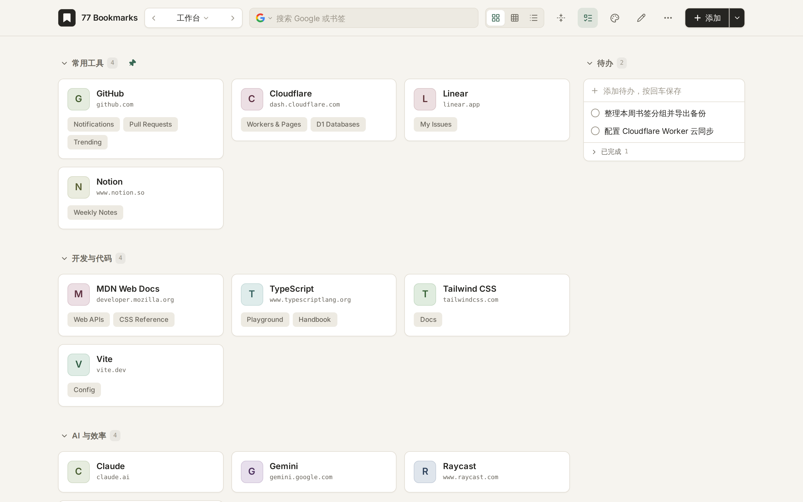
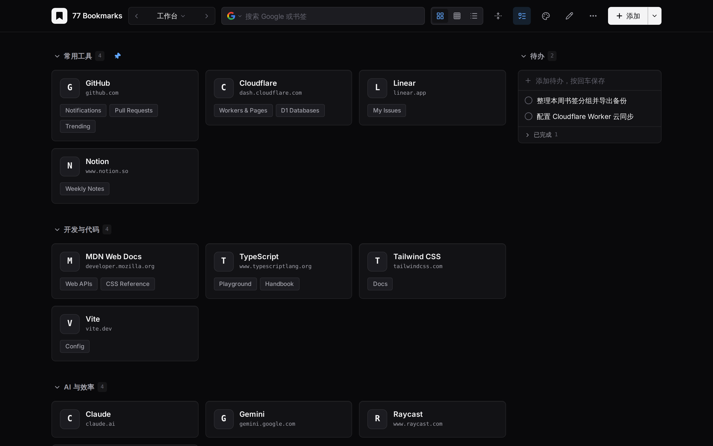

# 77 Bookmarks

[中文](README.md) | [English](README.en.md)

Chrome / Edge 本地新标签页扩展，也支持 Docker 自部署与配套的精简右键添加插件。两版共用同一套界面与数据服务。

支持多桌面、分组置顶、拖动排序、大卡片 / 小卡片 / 列表、可配置分组列数、按点击频率自动排序、跨桌面搜索、四种视觉风格（温润纸感 / 精密工作台 / 瑞士目录 / 柔和野兽派）、明暗主题、待办和点击统计。添加网址时，域名成为卡片，子路径成为卡片上的链接，同一桌面里的相同网站自动合并。

## 界面预览

| 浅色主题（温润纸感） | 深色主题（精密工作台） |
|---|---|
|  |  |

## Docker 自部署（可选）

适合多设备共用同一份书签、不替换浏览器新标签页的场景。数据存储在容器 `/data` 卷内的 SQLite 文件中，通过单用户密码登录；与扩展版使用相同的备份格式，可直接互相导入。

> 注：自部署版数据直接保存在服务端 SQLite 中，不提供扩展版的「云同步」配置项。

使用仓库源码构建并启动：

```bash
ADMIN_PASSWORD='your-strong-password' docker compose up -d --build
```

也可直接拉取 GitHub Container Registry 的预构建多架构镜像（`linux/amd64`、`linux/arm64`）：

```bash
docker run -d \
  --name 77bookmarks \
  --restart unless-stopped \
  -p 8080:8080 \
  -e ADMIN_PASSWORD='your-strong-password' \
  -v 77bookmarks-data:/data \
  ghcr.io/zxxx98/77bookmarks:latest
```

默认监听 `8080` 端口（可通过 `PORT=9000` 修改）。环境变量：

在「系统设置 → 版本更新」可检查并手动触发在线更新，容器需要能访问 GitHub 并配置自动重启。在线更新只修改当前容器内的应用文件，不更新镜像；删除并重建容器后会恢复为镜像中的版本。要更新镜像，请先更新源码，再运行 `docker compose up -d --build`；若使用引用远程镜像的 Compose 配置，则运行 `docker compose pull && docker compose up -d`。两种方式均应保留数据卷。

| 变量 | 说明 | 默认值 |
|---|---|---|
| `ADMIN_PASSWORD` | 登录密码，至少 8 个字符（必填） | 无 |
| `PORT` | 宿主机映射端口（compose）或容器内监听端口 | `8080` |
| `TRUST_PROXY` | 置于 HTTPS 反向代理后时设为 `true`，以识别 `X-Forwarded-*` | `false` |

外网访问建议挂在 HTTPS 反向代理（Nginx / Caddy / Traefik）后面；如果在反代层缓冲响应，建议对 `/api/events` 关闭缓冲以保证多标签实时刷新。

### 配套右键添加插件

自部署版不接管新标签页，可单独安装只有右键添加功能的精简插件：

- 直接从 [GitHub Releases](https://github.com/zxxx98/77bookmarks/releases) 下载 `77bookmarks-clipper-v*.zip` 并解压，或从源码构建：

```bash
npm install
npm run build:clipper
```

1. 打开 `chrome://extensions`（Edge 为 `edge://extensions`），开启「开发者模式」，加载解压后的目录或构建生成的 **`dist-clipper/`** 目录。
2. 登录自部署网页后，打开「更多 → 系统设置 → 右键插件」，点击「生成连接码」。
3. 点击插件图标（或打开插件选项页），粘贴连接码并授权访问你的服务器地址，选择默认桌面与分组。
4. 之后可在任意网页或链接上右键选择「添加当前网页到 77 Bookmarks」或「添加此链接到 77 Bookmarks」。

该插件权限仅包含 `contextMenus`、`storage`、`activeTab`、`scripting` 与你授权的那一个服务器地址；连接码只具备读取桌面列表与分组、添加书签的权限，不能修改、删除或导出数据。

## 扩展版安装与构建

需要 Chrome / Edge 120+。可直接从 [GitHub Releases](https://github.com/zxxx98/77bookmarks/releases) 下载 `77bookmarks-extension-v*.zip` 解压安装，或从源码构建（需要 Node.js 22.12+）：

```bash
npm install
npm run build:extension
```

1. 打开 `chrome://extensions`（Edge 为 `edge://extensions`），开启右上角的「开发者模式」。
2. 点击「加载已解压的扩展程序」，选择解压后的目录或项目生成的 **`dist-extension/`** 目录。`extension/` 是源代码目录，不能直接安装。
3. 打开一个新标签页。如果浏览器提示新标签页已被扩展更改，请保留该更改。
4. 可在扩展菜单中固定工具栏图标，便于收藏当前页面。

安装后日常使用无需运行 npm、Node.js 或本地服务。不要直接双击 HTML 文件。

更新时，重新解压或构建到同一路径，再在扩展管理页点击「重新加载」。保持相同的扩展目录和浏览器个人资料；不要为了升级卸载重装。切换扩展身份或目录前先导出备份。

如果同时安装了多个替换新标签页的扩展，请在扩展管理页选择启用哪一个。

## 收藏网页

- 点工具栏图标，选择桌面和分组，然后添加当前网页。
- 页面空白处右键，选择「添加当前网页到 77 Bookmarks」。
- 链接上右键，选择「添加此链接到 77 Bookmarks」。
- 默认快捷键 `Alt+Shift+B`，可在 `chrome://extensions/shortcuts` 修改。
- 右键菜单和快捷键沿用上次在弹窗中选择的桌面与分组；目标已删除时回到首个桌面及默认分组。
- 在书签桌面中也可以直接粘贴网址，或点「添加」。

新建分组：点击顶部「添加」旁的下拉箭头 →「新建分组」，输入名称并按 Enter，即可添加到当前桌面，无需进入编辑模式。手机上点击顶部「＋」打开同一菜单。

从当前页面收藏时使用浏览器已有的标题。在书签桌面的添加弹窗中粘贴或输入子网址后，会显示可编辑的「子链接名称」，先填入路径末段，并自动尝试读取网页标题。扩展已获网站访问权限时通过后台抓取；尚未授权时，可点击「读取网页标题」按需授权。请求最多等待 3 秒，失败时保留路径名称；你手动填写的名称不会被迟到的标题覆盖。点击添加会立即使用输入框中的名称保存，无需等待抓取。普通网页预览也会尝试读取，但受目标网站的跨域策略限制。网站卡片仍以域名命名，右键收藏链接仍以路径作为默认名称。

已有子链接可右键点击所属网站卡片，选择「编辑」，在「子链接」里修改名称，按 Enter 或点击输入框外保存；也可进入顶部「编辑」模式，点击卡片的铅笔图标进入。

只支持 `http://` 和 `https://` 书签，包括内网和 localhost。浏览器内部页面、扩展页面和 `file://` 地址不支持收藏。受限制页面无法注入提示时，通过工具栏角标显示结果。

## 本地数据与离线使用

扩展版的书签、待办、点击统计和已保存图标存储在扩展的 IndexedDB 中；轻量偏好镜像到 `chrome.storage.local`，页面用 `localStorage` 缓存启动外观。数据按浏览器个人资料隔离，不随浏览器账号自动同步。

- 断网时仍可查看、搜索、添加、编辑、排序、备份和恢复本地数据。
- 打开外部网站、在线搜索和显示未缓存的远程图片仍需网络。
- 修改先通过数据库事务持久化，再通知其他已打开的书签页刷新。
- 扩展后台按 Manifest V3 规则休眠；重新唤醒或重启浏览器后从数据库继续使用。

**请定期导出完整备份。卸载扩展、删除浏览器个人资料或清除其站点存储，会清除本地数据。**

扩展的书签数据独立保存，可通过 HTML 文件导入 Chrome / Edge 书签。

## 图标与权限

图标优先从 Chrome 的 favicon 缓存读取并保存到本地；没有可用图标时显示字母。卡片编辑支持上传图片（最多 100 KB）或填写图片的网络地址。上传和缓存的图标可以离线使用；仅保存地址的远程图标在离线时可能显示字母，备份只包含地址。

扩展版权限用途：

| 权限 | 用途 |
|---|---|
| `storage` | 保存扩展偏好及上次选择的收藏位置 |
| `contextMenus` | 页面和链接的右键收藏入口 |
| `activeTab` | 用户触发收藏时读取当前页面网址与标题 |
| `scripting` | 用户触发收藏后在页面显示结果提示 |
| `favicon` | 读取浏览器缓存的网站图标 |
| `alarms` | 启用同步后延迟上传和每 15 分钟检查云端 |
| 可选站点权限 | 用户授权后读取子网址的网页标题，或访问指定 WebDAV 服务器 |

不读取浏览历史。云同步默认关闭；关闭时不发起同步请求。仅在主动启用同步后，将下述同步数据上传到你配置的服务器。WebDAV 的站点访问权限按需申请。填写远程图标地址后，浏览器会向该地址请求图片。

## 备份与恢复

在「更多 → 系统设置 → 备份与恢复」操作：

- **完整备份（v3）**：包含全部桌面、分组、卡片、子链接、本地图标、点击统计、待办、系统设置、主题和搜索引擎偏好。
- **仅当前桌面（v2）**：多桌面时可单独导出该桌面，兼容旧版书签备份格式，不含全局设置、待办或统计。
- **添加为新桌面**：仅导入备份中的桌面，生成新的记录标识，不覆盖现有待办和全局设置。
- **替换全部数据**：替换全部桌面；v3 同时恢复备份内的待办、设置和统计。导入旧版书签备份时保留现有待办和设置。

导入前验证文件，在一个事务中保存；格式错误或写入失败会回滚，不会留下部分替换结果。最多 20 个桌面。

支持导入 v1/v2 书签备份，恢复文件中的桌面、分组、视图、置顶、卡片、链接及图标。这类文件不包含待办、系统设置和统计。

同一页面还支持导入 Chrome / Edge 导出的书签 HTML：在浏览器书签管理器里导出文件，选择后预览数量，导入为一个新桌面。嵌套文件夹成为分组，相同网站合并为一张卡片，非网页地址会跳过。

## 云同步（可选）

仅扩展版提供，在「更多 → 系统设置 → 云同步」配置，默认关闭。支持 **Cloudflare Worker + D1** 和 **WebDAV**。每台设备填写相同的服务器地址和凭据，勾选启用并保存；也可先点击「测试连接」。

- 同步桌面、分组、卡片、子链接、待办、点击统计和系统设置；主题、搜索引擎等偏好保留在各端。
- 图标图片和缓存状态不上传，各端按需从浏览器 favicon 缓存获取。自定义图标的网络地址会随卡片同步；上传的图片只留在本机及完整备份。
- 默认主桌面、默认分组使用固定同步标识；新卡片按「桌面同步标识 + origin（含协议和端口）」派生 SHA-256 标识，子链接按「卡片同步标识 + 路径」派生。同一网站可以存在于不同桌面。无 WebCrypto 的 HTTP 预览回退为随机标识，合并时仍会去重。
- 首次连接合并两边数据；后续按上次同步底稿做三方合并，识别删除。不同字段的修改可同时保留，同一字段冲突取修改时间较晚的一侧；修改与删除冲突时保留修改。点击计数按设备记录并合并，断网重试或上传响应丢失不会重复累加；备份保留计数来源，只有总数的历史导入取较大值。
- 扩展在浏览器启动、打开新标签页、本地改动约 30 秒后及每 15 分钟检查同步。断网时保留本地修改，下次触发自动重试。浏览器预览仅支持打开页面和手动同步，不运行扩展后台定时任务。
- 凭据仅保存在本机，不进入备份或同步快照。数据通过服务器保存，**未做端到端加密**；建议使用 HTTPS。每个 Worker 部署或 WebDAV 文件供同一用户的设备共用，不同用户应使用独立部署或目录。

### Cloudflare Worker + D1 一键部署

[](https://deploy.workers.cloudflare.com/?url=https%3A%2F%2Fgithub.com%2Fzxxx98%2F77bookmarks%2Ftree%2Fmain%2Fsync-worker)

1. 点击按钮，登录 Cloudflare 并授权 GitHub。模板会复制独立的 `sync-worker/`，自动创建并绑定 D1 数据库 `DB`。
2. 在部署页面填写 **`SYNC_TOKEN`**：使用至少 32 字符的随机令牌，推荐执行 `openssl rand -hex 32` 生成。保存该令牌，所有设备需填写相同值；不要使用示例占位值。
3. 完成部署，复制 `https://77bookmarks-sync.<你的账号>.workers.dev`。在扩展云同步中选择 Cloudflare Worker，填写该地址（不带 `/v1/snapshot`）和令牌，启用并保存。数据库表会在首次请求时自动建立，无需手动执行 SQL。

按钮以公开仓库 `main` 上的 `sync-worker/` 为模板；本地开发中的变更需要先发布到仓库，按钮才会包含这些变更。Cloudflare 页面如未提示填写令牌，请在 Worker 的「Settings → Variables and Secrets」新增 Secret `SYNC_TOKEN` 后重新部署。

命令行部署（Node.js 22 或更新版本）：

```bash
cd sync-worker
npm ci
npx wrangler login
npm run deploy              # 首次按提示创建 D1，并将实际 database_id 写入配置
npx wrangler secret put SYNC_TOKEN
```

如需手动执行迁移，可运行 `npm run db:migrate`。本地调试先将 `.dev.vars.example` 复制为 `.dev.vars`，填入自己的令牌，再运行 `npm run dev`。不要提交 `.dev.vars`。

Worker 使用带版本号的条件写入，冲突时客户端重新拉取合并；保留最近 **10** 份快照，每份最多 **4 MB**（UTF-8 字节）。`GET /v1/history` 可查看版本，`GET /v1/snapshot?version=版本号` 可取回历史快照，均需 `Authorization: Bearer <SYNC_TOKEN>`。恢复时先停用所有设备同步，将取回的 `{snapshot}` 使用当前版本的 `If-Match` 写回 `PUT /v1/snapshot`；再启用各端同步。云端留存不能替代完整备份。

### WebDAV

1. 在坚果云、Nextcloud 或 NAS 中先创建同步目录，建议使用专用应用密码。
2. 在云同步中选择 WebDAV，填写目录完整地址、账号和密码。例如 `https://dav.jianguoyun.com/dav/77bookmarks/`。
3. 在扩展中点击「授权访问」，只授予该服务器的站点权限，再启用并保存。目录内会生成 `77bookmarks-sync.json`，也可直接填写 JSON 文件的地址。

服务器必须为同步文件提供**强 ETag**，并正确支持 `If-Match` / `If-None-Match` 条件写入；否则客户端会报错并停止，避免多设备并发覆盖。初次创建文件也使用条件写入。部分服务器或反向代理会移除 ETag，需要先调整配置，或改用 Worker。测试连接只验证读取权限，首次同步才验证创建、写入权限。

WebDAV 通常不提供浏览器跨域支持，建议在已安装的扩展中使用。HTTP 界面预览访问 WebDAV 时，服务器还需允许该预览来源、`Authorization` / 条件请求头，并暴露 `ETag`；Worker 已包含所需 CORS 配置。

## 快捷操作

| 按键 | 作用 |
|---|---|
| `←` / `→`，`Tab` / `Shift+Tab` | 切换桌面（触屏可左右滑动） |
| `Alt+C` | 折叠 / 展开当前桌面分组 |
| `Alt+T` | 展开待办并聚焦添加框 |
| 数字、字母 | 聚焦搜索框并输入 |
| `Ctrl+V` / `⌘V` | 剪贴板是有效网址时打开添加窗口 |
| `Enter` | 搜索，或完成布局编辑 |
| `Shift+Enter` | 打开第一个匹配书签 |
| `Esc` | 关闭弹窗或退出布局编辑 |

新标签页打开后默认可能聚焦地址栏。点击页面后，上述页面快捷键生效。

## 开发与验证

```bash
npm run dev            # http://localhost:8788，带热更新
npm run typecheck
npm test
npm run build          # 生成扩展版 dist/ 和 dist-extension/
npm run build:selfhost # 生成自部署版 dist-selfhost/
npm run build:clipper  # 生成精简右键插件 dist-clipper/
npm run preview        # http://localhost:8788，预览构建结果
```

HTTP 预览直接使用同一套 IndexedDB 数据服务，只供界面开发。它与已安装扩展是不同来源，数据各自独立；右键、工具栏和新标签页替换应在真实扩展中测试。不要依赖 Vite 开发服务器运行已安装扩展；扩展应加载生产构建。

浏览器集成检查：

```bash
npx playwright install chromium  # 首次安装测试用浏览器
npm run test:extension            # 先构建，再在临时浏览器资料中测试
npm run test:drag:extension       # 拖动后的动画落点、逐帧顺序、跨分组移动与取消
npm run ci --prefix sync-worker
npm run test:sync:extension       # 两个扩展资料 + 本地真实 Worker/D1 + WebDAV 条件写入
```

也可用 `CHROME_PATH=/path/to/chrome npm run test:extension` 指定兼容的 Chromium。测试覆盖 Manifest V3 CSP、断网操作、多标签页并发与刷新、新标签页入口、收藏弹窗、JSON 完整备份恢复、Chrome HTML 导入、后台重启和浏览器重启，结果截图与备份写入忽略提交的 `artifacts/`。

后端独立验证：`npm ci --prefix sync-worker`、`npm run typecheck --prefix sync-worker`、`npm run deploy --prefix sync-worker -- --dry-run`。同步合并、两设备离线改动、传输层条件写入以及 Worker 的 SQLite 并发与版本保留测试均包含在根目录 `npm test` 中（Node.js 22 或更新版本）。

目录：`sync-worker/` 为可独立部署的同步服务，`server/` 为自部署版 Node 服务与 SQLite 存储，`clipper/` 为精简右键添加插件，`src/platform/` 为两版适配层，`src/sync/` 为客户端同步，`src/` 为 React 界面，`src/storage/` 为本地数据层，`shared/` 为类型与备份校验，`extension/` 为完整扩展入口、弹窗和 Manifest，`scripts/` 为打包与浏览器检查。
